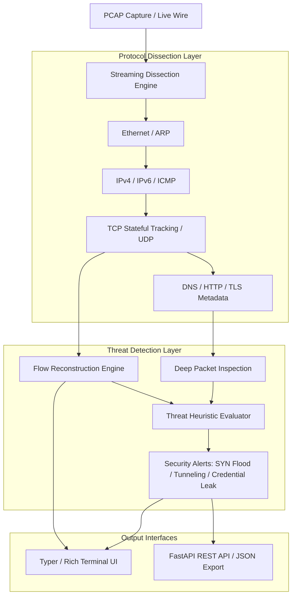

# Network Packet Analysis Tool (`packet-analyzer`)

High-performance Network Packet Analysis, Deep Packet Inspection (DPI) engine, and active cyber threat detector built in Python 3.12.

[](https://github.com/Krish9800/packet-analyzer/actions)
[](LICENSE)
[](https://www.python.org/)
[](https://scapy.net/)
[](https://typer.tiangolo.com/)

---

## Overview & Problem Statement

Network security monitoring demands more than simple IP and port filtering. Attackers leverage protocol tunneling, encrypted command-and-control (C2) channels, and micro-burst port sweeps that evade superficial inspection tools.

**Packet Analyzer** is an enterprise-inspired packet dissection and network forensics utility. It decodes raw PCAP captures and live network streams, reconstructs bi-directional TCP/UDP conversations, extracts TLS ClientHello metadata and DNS queries, and runs heuristic threat detection algorithms to isolate malicious activity on the wire.

---

## Architecture & Data Flow



---

## Verified Features

- **Multi-Layer Protocol Dissection:** Full decoding of Ethernet, ARP, IPv4, IPv6, ICMP, TCP, UDP, DNS, HTTP, and TLS.
- **Stateful TCP Flow Tracking:** Reconstructs conversations with sequence tracking, flags analysis (SYN/ACK/FIN/RST), duration, and byte volume.
- **Deep Packet Inspection (DPI):**
  - **TLS ClientHello Parsing:** Extracts SNI (Server Name Indication), cipher suites, and TLS version.
  - **DNS Forensics:** Query types (A, AAAA, TXT, MX), Shannon entropy calculation for DNS tunneling detection.
  - **HTTP Decoders:** Method, Host, URI, User-Agent, and cleartext credential leakage detection.
- **Heuristic Threat Detection:**
  - SYN Flood and TCP reset scanning
  - Horizontal and vertical port sweeps
  - High-entropy DNS tunneling channels
  - Cleartext password/token transmissions
- **Dual Interface:** High-speed CLI powered by Typer and Rich formatting, plus a headless FastAPI inspection service.

---

## Technology Stack

- **Core Engine:** Python 3.12+
- **Packet Dissection:** Scapy 2.5+
- **Data Models:** Pydantic v2
- **CLI & Formatting:** Typer & Rich
- **REST Service:** FastAPI & Uvicorn
- **Testing:** Pytest, Ruff, Mypy, Bandit

---

## Requirements & Installation

### Requirements
- Linux / macOS / WSL2 on Windows
- Python 3.12+
- `libpcap` installed on system (for live sniffing)

### Installation

```bash
# Clone the repository
git clone https://github.com/Krish9800/packet-analyzer.git
cd packet-analyzer

# Create and activate virtual environment
python3 -m venv .venv
source .venv/bin/activate

# Install package and dependencies
pip install -e .
```

---

## Verified Usage Examples

### 1. Command-Line Interface (CLI)

```bash
# Analyze a PCAP capture file with full threat detection
pktanalyzer analyze captures/traffic_sample.pcap --detect-threats

# Analyze with custom BPF filter and output JSON
pktanalyzer analyze captures/traffic_sample.pcap --filter "tcp port 443" --format json

# Reconstruct and list all stateful network flows
pktanalyzer flows captures/traffic_sample.pcap --min-packets 5 --sort-by bytes

# Check version and loaded dissectors
pktanalyzer version
```

### 2. REST API Service

```bash
# Launch the API service
uvicorn pktanalyzer.api.app:app --host 127.0.0.1 --port 8000
```

Available Endpoints:
- `GET /health` — Service health check
- `POST /api/v1/analyze/upload` — Upload a PCAP file for asynchronous dissection
- `GET /api/v1/flows` — List reconstructed TCP/UDP network flows
- `GET /api/v1/flows/{session_id}` — Inspect detailed packet breakdown for a specific conversation
- `GET /api/v1/alerts` — Retrieve all identified security threats and anomalous indicators

---

## Testing & Quality Gates

```bash
# Run all unit, integration, and security tests
pytest --cov=pktanalyzer --cov-report=term-missing

# Run protocol dissection tests specifically
pytest tests/unit/test_dissectors.py

# Lint and formatting validation
ruff check .
ruff format --check .

# Static type checking
mypy src/pktanalyzer
```

---

## Security Model & Safe Scope

- **Passive Inspection:** Operates strictly as a passive network sniffer or offline capture reader. Does not inject packets, modify traffic, or perform active network jamming.
- **Privilege Separation:** PCAP analysis on stored `.pcap` files runs with standard non-root privileges. Live sniffing requires `CAP_NET_RAW` or `sudo`.
- **Memory Safety:** Incorporates packet count limits and streaming generators to prevent OOM errors on large capture files.

---

## Limitations & Known Issues

- **Live Capture Privileges:** Live wire sniffing requires root permissions (`sudo`) on Linux systems to access raw network sockets.
- **Encrypted Payloads:** Deep payload inspection is restricted to unencrypted protocols (HTTP, DNS) and TLS handshake metadata (SNI). Encrypted application traffic is analyzed via flow heuristics rather than decryption.

---

## License & Responsible Use

This project is licensed under the **MIT License** — see the [LICENSE](LICENSE) file for details.

> [!NOTE]
> **Defensive Scope:** Packet analysis must be conducted only on networks and packet captures you own or have explicit administrative authorization to monitor.
