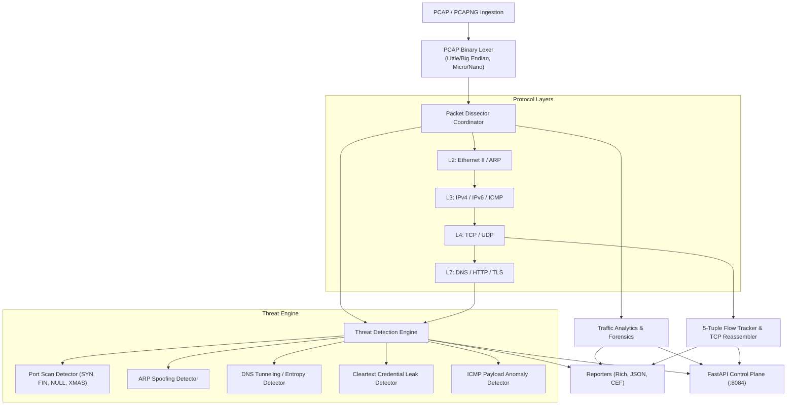

# Packet Analyzer Architecture Specification

## 1. Executive Summary

`packet-analyzer` is a high-performance, modular Network Packet Analysis and Deep Packet Inspection (DPI) engine. It provides zero-dependency binary parsing of Libpcap capture streams, multi-layer protocol dissection across L2 to L7, stateful TCP conversation tracking with bidirectional byte-stream reassembly, and real-time active threat detection against port scanning, ARP poisoning, DNS tunneling, and cleartext credential exposures.

## 2. Core Subsystems

### 2.1 PCAP Binary Lexer (`pktanalyzer.core.reader`)
- Zero-dependency parsing of Libpcap format (RFC / libpcap specification).
- Supports 4 global header variants:
  - Little-endian microseconds (`0xa1b2c3d4`)
  - Big-endian microseconds (`0xd4c3b2a1`)
  - Little-endian nanoseconds (`0xa1b23c4d`)
  - Big-endian nanoseconds (`0x4d3cb2a1`)
- Memory-efficient streaming generator yielding `RawPacket`.
- Bundled `PCAPWriter` for synthetic packet generation and forensic packet carving.

### 2.2 Layered Protocol Dissectors (`pktanalyzer.dissectors`)
- **L2**: `EthernetFrame` (MAC formatting, 802.1Q VLAN handling), `ARPPacket` (hardware/protocol resolution).
- **L3**: `IPv4Packet` (IHL options, DSCP/ECN, fragmentation), `IPv6Packet`, `ICMPPacket`.
- **L4**: `TCPSegment` (Flags bitmask, sequence numbers, data offset options), `UDPDatagram`.
- **L7**:
  - `DNSMessage`: RFC 1035 parsing with compression pointer resolution, Questions and Answers (A, AAAA, CNAME, TXT).
  - `HTTPMessage`: Request methods, HTTP status codes, headers dictionary, body extraction.
  - `TLSMessage`: Record layer header, Handshake ClientHello, and Server Name Indication (SNI) extension hostname parsing.

### 2.3 TCP Stream Reassembly & Flow Engine (`pktanalyzer.core.flow`)
- Symmetric `FlowKey` canonicalization for bidirectional 5-tuple conversations.
- `HalfStream` tracks expected sequence numbers, out-of-order segment queueing, and retransmission deduplication.
- Lifecycle tracking: `SYN_SENT`, `SYN_RECEIVED`, `ESTABLISHED`, `CLOSED`.

### 2.4 Cyber Threat Detection Engine (`pktanalyzer.threats`)
- **PortScanDetector**: Sliding time-window tracking for rapid SYN sweeps and stealth scans (NULL, FIN, XMAS).
- **ARPSpoofDetector**: Dynamic IP-to-MAC binding cache detecting ARP cache poisoning and conflicting claims.
- **DNSTunnelDetector**: Shannon entropy metric $H \ge 3.8$ on domain labels and oversized TXT responses.
- **CredentialLeakDetector**: Detects cleartext Basic auth, Bearer tokens, and sensitive POST body parameters over unencrypted HTTP.
- **ICMPAnomalyDetector**: Flags oversized ICMP payloads (> 128 bytes) indicating covert channel tunneling.

### 2.5 Analytics & Telemetry API
- `AnalyticsEngine`: Bandwidth throughput (B/s, pkt/s), protocol hierarchy breakdown, top communicating endpoints.
- `pktanalyzer` Typer CLI: interactive Rich terminal tables, structured JSON, and SIEM CEF formats.
- FastAPI REST Control Plane: PCAP upload, flow inspection, and security alert streaming on port 8084.
